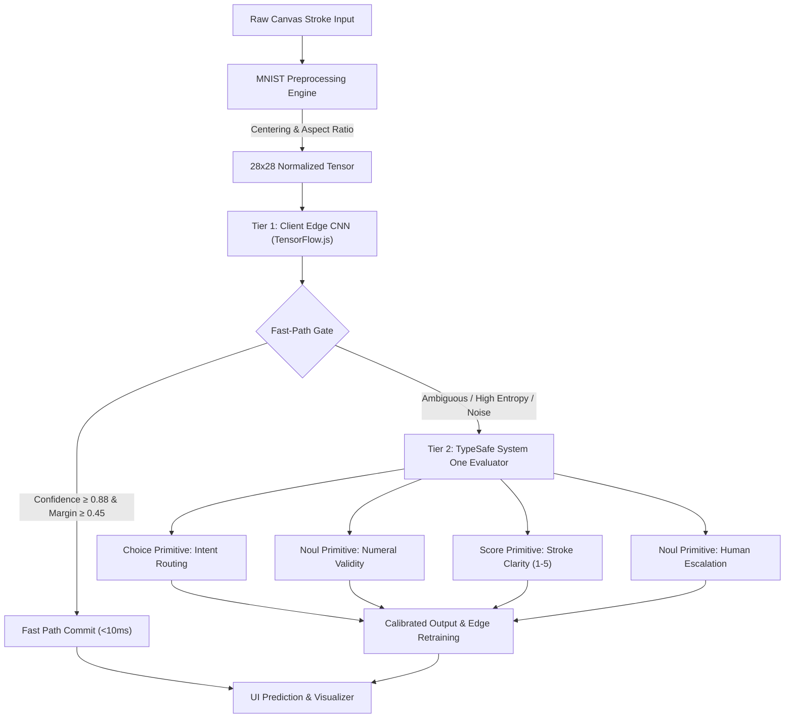

<div align="center">

#  DigitDraw
### Handwritten Digit Intelligence & Apple-Inspired Fluid Design

[](https://opensource.org/licenses/MIT)
[](https://js.tensorflow.org)
[](https://react.dev)
[](https://vitejs.dev)
[](https://en.wikipedia.org/wiki/MNIST_database)
[](https://docs.typesafe.ai)
[](https://developer.apple.com/design/)

*A photography-first, high-precision digit recognition studio that combines real-time client-side Convolutional Neural Networks with TypeSafe System One (Jev) semantic evaluation and an Apple-inspired fluid interactive game.*

[Live Studio](#-interactive-studio-workspace) • [Arcade Game](#-digit-sprint-arcade-game) • [TypeSafe Routing](#-typesafe-system-one-evaluation--routing) • [CNN Architecture](#-convolutional-neural-network-topology) • [Quickstart](#-quick-start)

---

</div>

## ✦ Key Innovations

- **Instantaneous 60Hz Drawing Pipeline**: Evaluates strokes in real time as the stylus or finger glides across the canvas using sub-frame `requestAnimationFrame` scheduling and Pointer Events capture.
- **True MNIST Normalization**: Implements research-grade bounding box extraction, aspect-ratio scaling to 20×20, and **Center-of-Mass** translation to $(14, 14)$ inside the $28 \times 28$ tensor.
- **Apple Human Interface Design**:
  - Precision SF Pro typography with signature negative tracking (`-0.028em`).
  - Tactile physical response with instant `active:scale-95` micro-interactions.
  - Alternating museum-gallery surface rhythms (Pure Canvas `#ffffff`, Parchment `#f5f5f7`, Near-Black Tiles `#272729`).
  - Action Blue (`#0066cc`) interactive accents with frosted glass materials (`backdrop-filter: blur(20px)`).
- **Digit Sprint Arcade Game**: Fast-paced speed challenge challenging users to draw target digits under clock pressure with Web Audio synthesized chords, streak multipliers, and high score tracking.
- **TypeSafe AI System One Routing**: Dual-tier inference cascade using TypeSafe's Jev model primitives (`Choice`, `Noul`, `Score`) to calibrate ambiguity, detect out-of-distribution scribbles, and grade stroke legibility.
- **100% On-Device & Zero-Cloud**: Runs entirely within browser memory (WebGL / WASM), with on-device backpropagation fine-tuning persisted in IndexedDB.

---

## 🏛 System Architecture

The system utilizes a **dual-tier decision cascade** that separates fast, deterministic edge classification from semantic evaluation:



---

## 🔬 Convolutional Neural Network Topology

The edge model is an optimized 8-layer deep CNN trained on MNIST, compiled down to just **33,194 parameters (132 KB)**:


| Layer | Type | Output Shape | Parameters | Function |
|---|---|---|---|---|
| 0 | Input | `[None, 28, 28, 1]` | 0 | Normalized grayscale tensor |
| 1 | Conv2D | `[None, 26, 26, 16]` | 160 | Edge & corner feature detection |
| 2 | MaxPooling2D | `[None, 13, 13, 16]` | 0 | Spatial downsampling |
| 3 | Conv2D | `[None, 11, 11, 32]` | 4,640 | Loop & stroke intersection filters |
| 4 | MaxPooling2D | `[None, 5, 5, 32]` | 0 | Spatial abstraction |
| 5 | Conv2D | `[None, 3, 3, 32]` | 9,248 | High-level numeral topology |
| 6 | Flatten | `[None, 288]` | 0 | Feature map vectorization |
| 7 | Dense | `[None, 64]` | 18,496 | Non-linear dense representation |
| 8 | Dense (Softmax)| `[None, 10]` | 650 | Categorical probability distribution |

---

## ⚡ TypeSafe System One Evaluation & Routing

Following the [TypeSafe AI Guidelines](https://docs.typesafe.ai), the application treats units of intelligence as programmable primitives. When fast edge inference encounters ambiguous inputs (e.g., distinguishing `'1'` vs `'7'`, `'4'` vs `'9'`, or random non-digit drawings), the **TypeSafe System One Evaluator** executes parallel semantic judgments:

### 1. `Choice` Primitive — Semantic Intent Routing
Picks exactly one category from a defined set without requiring threshold guesswork:
```typescript
const intent = await jev.choice({
  question: "What category best describes this drawn sketch?",
  criteria: [
    "single_digit",
    "multi_digit_number",
    "latin_alphabet",
    "mathematical_symbol",
    "doodle_or_noise"
  ],
  state: { strokeCount: 2, aspectRatio: 1.1, pixelCoverage: 0.14 }
});
```

### 2. `Noul` Primitive — Calibrated Validity & Escalation
Returns the probability of whether a condition holds ($[0.0, 1.0]$):
```typescript
const validity = await jev.noul({
  question: "Is this sketch an intentional, valid representation of an Arabic numeral (0-9)?",
  state: { imageMetrics, predictionMargin: 0.12 }
});
```

### 3. `Score` Primitive — 5-Level Stroke Legibility
Computes a probability-weighted scalar across self-contained descriptive levels:
```typescript
const clarity = await jev.score({
  question: "Grade the structural legibility and completeness of the drawn character.",
  levels: [
    "1: Illegible scribble or noise",
    "2: Heavily distorted or missing critical strokes",
    "3: Acceptable with atypical stroke variation",
    "4: Clear, standard handwritten numeral",
    "5: Textbook pristine exemplar"
  ],
  state: { strokeContinuity: 0.94, aspectRatio: 0.85 }
});
```

---

## 🎮 Digit Sprint Arcade Game

Experience digit drawing as an Apple Arcade-inspired speed challenge:
- **Beat the Clock**: 7-second countdown per numeral across 8 rounds.
- **Real-Time Detection**: Automatically recognizes target matches with $>75\%$ confidence.
- **Combo Multipliers**: Build consecutive streaks ($2\times, 3\times$) for score multipliers.
- **Tactile Sound Synthesis**: Web Audio API generates Apple-style marimba triads and chime celebrations.
- **High-Score Persistence**: Local records stored seamlessly in browser storage.

---

## 📐 Mathematical Preprocessing Formulation

Raw canvas drawing suffers from translation and scale variances. We implement the formal MNIST algorithm:

1. **Bounding Box Crop**:
   $$\text{box} = [x_{\min}, y_{\min}, x_{\max}, y_{\max}]$$
   The largest dimension is scaled to fit within a $20 \times 20$ box preserving aspect ratio:
   $$s = \frac{20}{\max(w_{\text{box}}, h_{\text{box}})}$$

2. **Center of Mass Centroid**:
   $$c_x = \frac{\sum_{x,y} x \cdot I(x, y)}{\sum_{x,y} I(x, y)}, \quad c_y = \frac{\sum_{x,y} y \cdot I(x, y)}{\sum_{x,y} I(x, y)}$$

3. **Center Alignment**:
   The scaled image is translated on a $28 \times 28$ canvas such that the center of mass $(c_x, c_y)$ is placed precisely at $(14, 14)$.

---

## 🚀 Quick Start

### 1. Web Application (React + Vite + TensorFlow.js)

```bash
# Clone the repository
git clone https://github.com/Rahul08319/digit-draw.git
cd digit-draw

# Install dependencies
npm install

# Start development server
npm run dev

# Build production bundle
npm run build
```

Open [http://localhost:5173](http://localhost:5173) in your browser.

### 2. Python ML Suite & Backend API

```bash
# Install Python dependencies
pip install -r requirements.txt

# Train deep CNN on MNIST (Generates models/mnist_cnn.keras)
python train_model.py

# Evaluate test accuracy & confusion matrix
python evaluate.py

# Test TypeSafe System One Router
python typesafe_router.py

# Start FastAPI server
python app.py
```

The FastAPI REST documentation will be available at [http://127.0.0.1:8000/docs](http://127.0.0.1:8000/docs).

---

## 📂 Project Structure

```
digit-draw/
├── public/
│   └── model/                     # Pre-trained bundled CNN weights
│       ├── model.json             # Model topology & manifest
│       └── my-mnist01.weights.bin # 132 KB trained binary weights
├── src/
│   ├── components/
│   │   ├── AppleGlobalNav.tsx     # 44px frosted navigation bar
│   │   ├── AppleFooter.tsx        # Museum-grade IA footer
│   │   ├── ArchitectureView.tsx   # Engineering & math specification
│   │   ├── DigitGameMode.tsx      # Digit Sprint Arcade game
│   │   ├── DrawingCanvas.tsx      # Retina canvas with 60Hz real-time tracking
│   │   ├── ModeSelector.tsx       # Apple segmented pill switch
│   │   ├── ModelControls.tsx      # On-device weight export & import
│   │   ├── NeuralNetworkViz.tsx   # 8-layer CNN topology visualizer
│   │   ├── PredictionDisplay.tsx  # Confidence meters & correction UI
│   │   └── TypeSafeRoutingPanel.tsx # System One routing inspector
│   ├── hooks/
│   │   └── useDigitRecognition.ts # Real-time inference & backprop hook
│   ├── lib/
│   │   ├── mnistPreprocessing.ts  # Center-of-mass & bounding box math
│   │   ├── soundEffects.ts        # Web Audio API Apple chime generator
│   │   └── typesafeRouting.ts     # System One Jev models implementation
│   ├── pages/
│   │   └── Index.tsx              # Main studio application
│   ├── index.css                  # Apple design system CSS tokens
│   └── main.tsx
├── app.py                         # FastAPI REST prediction server
├── evaluate.py                    # Test metrics & confusion matrix
├── train_model.py                 # TensorFlow/Keras CNN training pipeline
├── typesafe_router.py             # TypeSafe System One Python router
├── requirements.txt               # Python package manifest
├── package.json                   # Node package manifest
├── tailwind.config.ts             # Tailwind Apple color & typography tokens
└── vite.config.ts                 # Vite bundle configuration
```

---

## 📜 License

Distributed under the **MIT License**. Created by [Rahul](https://github.com/Rahul08319).
Designed with Apple Human Interface Principles and TypeSafe AI.
